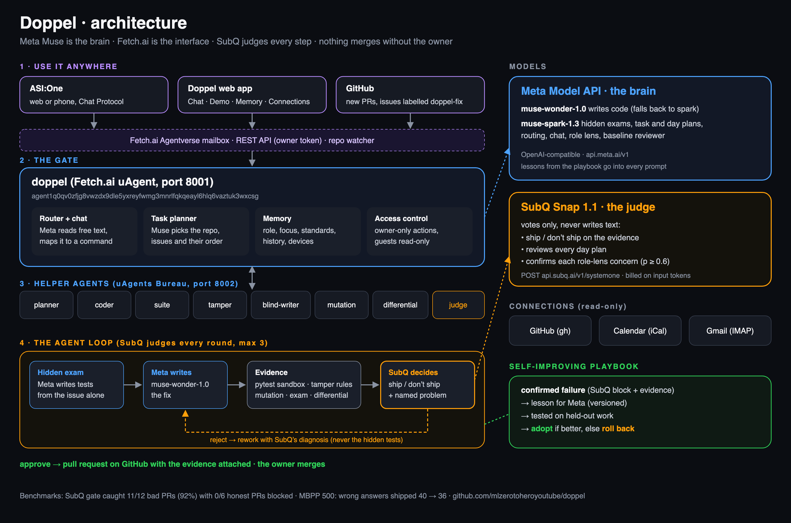

# Doppel

**Your double. It knows your work, does it behind the scenes, double-checks itself, and only asks you when it must.**

Doppel is a personal engineering agent with double verification. Meta Muse does the work, SubQ independently
decides what ships, deterministic checks supply the evidence, and a personal layer remembers your repos, your day
and your rules. It works quietly in the background (checking PRs, fixing issues, planning) and only interrupts you
when something needs you. Built for the *Trust but Verify* track of the AIE Code Summit Hackathon (Nov 7, 2026).

> **SubQ stopped 11 of 12 bad AI pull requests (92%) from shipping, and blocked 0 of 6 honest ones.**
> Meta alone either missed more (10 of 12 with its hidden exam) or blocked honest work (2 of 6 as a plain reviewer).
>
> **And it's almost free:** 1,545 SubQ calls reading 2.54 million tokens cost **$0.10 in total**. [Benchmarks ↓](#benchmarks-where-doppel-beats-meta-alone)

**Talk to it in ASI:One:** [doppel](https://asi1.ai/ai/agent1q0qv0zfjg8vwzdx9dle5yxreyfwmg3mnrlfqkqeayl6hlq6vaztuk3wxcsg)
(`agent1q0qv0zfjg8vwzdx9dle5yxreyfwmg3mnrlfqkqeayl6hlq6vaztuk3wxcsg`) · demo repos:
[receipts-demo-store](https://github.com/mlzerotoheroyoutube/receipts-demo-store),
[receipts-demo-calendar](https://github.com/mlzerotoheroyoutube/receipts-demo-calendar)

## What it does

From one chat in ASI:One (web or the ASI:One phone app), in plain English:

| You say | Doppel does |
|---|---|
| "is https://github.com/…/pull/4 safe to merge?" | Verifies the PR: 🛑 BLOCK / ⚠️ WARN / ✅ PASS with evidence, posts an official **Doppel** status check and a report comment on GitHub |
| "keep an eye on owner/repo" | Watches the repo and checks every new PR or push on its own; interrupts you on a BLOCK, otherwise holds results for a digest during quiet hours |
| "fix the 12-hour time bug in my calendar repo" | Finds the issue, Meta writes a hidden exam and the fix, Doppel collects evidence, SubQ judges, it reworks until approved, then **opens a real PR** |
| Label an issue `doppel-fix` on GitHub | Same fix loop, started from GitHub; progress and the PR link are posted on the issue |
| "new project habit-tracker: a CLI for habits and streaks" | After you confirm: creates the repo, a Meta-written starter project whose tests pass, and three starter issues |
| "today: ship the fixes, demo at 5pm, meetings 1-3pm" / "what's my schedule" | Meta plans the day, SubQ reviews the plan |
| "my repos", "what PRs are open in …", "open an issue in …" | Runs your GitHub |

Your memory (plan, watched repos, strictness, feedback) follows you across devices: `link <name>` in chat,
and the same name over the HTTP API.

## How it's built



([SVG version](docs/architecture.svg))

| Layer | Job | Who |
|---|---|---|
| Agents and publishing | Gate (chat protocol, memory, watcher, HTTP API), planner, coder and six verifier workers | **Fetch.ai** uAgents, published on **Agentverse**, used from **ASI:One** |
| Models | Coding loop (`muse-wonder-1.0`, falls back to `muse-spark-1.3`); hidden exam, planning, plain-English routing, scaffolding (`muse-spark-1.3`) | **Meta** Model API |
| Judge | Ships or not: every coding round, every verified PR (gate rule J001), blind-test validity, daily plans | **SubQ** Snap 1.1 (decision model, `POST /v1/systemone`) |
| Ground truth | Test suite, tamper rules T001–T008, planted bugs (mutation), before/after differential | Deterministic, no model |

```
ASI:One / phone / HTTP ──▶ doppel ──┬─ suite · tamper · differential · mutation   (deterministic)
                                           ├─ blind-writer (Meta, sees only the issue)  ─┐
                                           ├─ judge (SubQ, sees evidence, never code)    ├─ evidence
                                           ├─ coder: Meta writes ▶ evidence ▶ SubQ judges ▶ rework ≤3 ▶ PR
                                           └─ planner: Meta drafts ▶ SubQ reviews
```

**Why it's hard to game:** the test writer only ever receives the issue and the public interface (the
message schema can't carry code); the coding model never sees the hidden exam, only the judge's feedback
with test names stripped; blind tests run with `--noconftest` and an empty config; every model call is
cached by a hash of its inputs, so any verdict can be replayed exactly.

## Benchmarks: where Doppel beats Meta alone

**Headline: SubQ saved 11 of 12 failures (92%).** Of 12 cheating or broken pull requests, the SubQ
ship/don't-ship gate stopped 11 before they shipped, without blocking a single honest one.

**1. Catching bad AI pull requests** (18 PRs: 12 cheating or broken, 6 honest)

| | Bad PRs caught | Honest PRs wrongly blocked |
|---|---|---|
| Meta alone, as a plain AI reviewer | 12/12 | **2/6 (33%)** |
| Meta writing a hidden exam, no SubQ | 10/12 | 0/6 |
| **Doppel: evidence + SubQ ship/don't-ship gate** | **11/12 (92%)** | **0/6** |

**2. MBPP, 500 coding tasks** (Google Research, official hidden tests)

| | Wrong answers shipped | Shipped answers correct |
|---|---|---|
| Meta alone | 40 | 92.0% |
| **Meta + Doppel + SubQ** | **36** | **92.7%** |

**What SubQ cost for everything we ran today:** 1,545 calls, 2,540,936 input tokens, **$0.10 in total**
(about $0.00007 per decision, at $0.04 per million input tokens; output is free). Every call is logged with its
token count, so the total is summed from the logs, not estimated. Raw results: [`benchmark/results/`](benchmark/results/); MBPP data:
[google-research/mbpp](https://github.com/google-research/google-research/tree/master/mbpp).

## Run it

```bash
uv venv && uv pip install -e .
# .env (git-ignored): MODEL_API_KEY=… SUBQ_API_KEY=… RECEIPTS_GATE_SEED=… RECEIPTS_API_TOKEN=…
python -m receipts.agents.run                     # gate on :8001 (Agentverse mailbox) + 8 helpers on :8002
python -m receipts.client --user me "what's my schedule today"           # HTTP client, any device
python -m receipts verify --github-pr https://github.com/owner/repo/pull/N --gate   # one-off CLI check
python -m benchmark.run --subq-gate --tag subq-gate   # benchmark 1
python -m benchmark.long_bench --report               # benchmark 2 (long)
python -m benchmark.decisions --report                # benchmark 3
```

GitHub Actions: copy [docs/receipts-workflow.yml](docs/receipts-workflow.yml) to `.github/workflows/` and add
`MODEL_API_KEY` and `SUBQ_API_KEY` as repo secrets; every PR then gets a Doppel check in GitHub's cloud.

## Built at the hackathon

Everything in this repository was written during the event on Nov 7, 2026; the git history shows it.

- `receipts/`: verifier (`blind.py`, `tamper.py`, `mutation.py`, `sandbox.py`, `verify.py`), work loop
  (`loop.py`), planner (`planner.py`), GitHub publishing and operations (`publish.py`, `github_ops.py`),
  model routing with replay cache (`llm.py`), HTTP client (`client.py`), CLI (`__main__.py`)
- `receipts/agents/`: the uAgents: gate (chat protocol, memory, watcher, HTTP API, plain-English routing),
  planner, coder, six verifier workers
- `demo_store/`, `benchmark/fixtures/`: sample projects and their issues
- `benchmark/`: the 18-PR benchmark, coding / long-horizon / vertical / MBPP runners, the decision benchmark,
  and every hidden grader in `benchmark/graders/`

## Not ours

- [pytest](https://pytest.org) (MIT), [uAgents](https://github.com/fetchai/uAgents) (Apache-2.0),
  [OpenAI Python SDK](https://github.com/openai/openai-python) (Apache-2.0, client for the Meta and SubQ APIs),
  [Anthropic Python SDK](https://github.com/anthropics/anthropic-sdk-python) (MIT)
- The Meta Model API, SubQ API, Fetch.ai Agentverse and ASI:One
- **MBPP** (Mostly Basic Python Problems), Google Research, **CC-BY 4.0**:
  [google-research/mbpp](https://github.com/google-research/google-research/tree/master/mbpp);
  stored unchanged in `benchmark/data/mbpp/`
- Claude Code was used as a coding assistant.

## License

MIT
