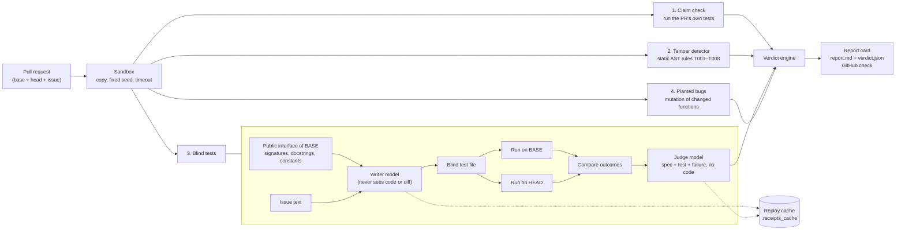

# Receipts: Product, Architecture and Plan

AIE Code Summit Hackathon · Nov 7, 2026 · Track: **Trust but Verify** · Solo build

---

## 0. The full vision: a teammate that only ships what it can prove

You tell it your targets and schedule. It watches your repos, checks every new PR, fixes issues
itself in a loop, and opens a PR only when independent checkers agree the work is right.

### Four model families, one job each

| Role | Model | Why this one |
|---|---|---|
| **Implementer**: writes and reworks code | Claude Opus 5.5 (Anthropic) | Strongest coding agent |
| **Examiner**: writes the hidden blind tests; **Planner**: plans the day | Meta Muse Spark 1.3 | A different lab from the implementer, so the exam doesn't share the coder's blind spots. Multimodal, so it can later read a screenshot of your calendar |
| **Judge**: rules on every loop round and on the final result | SubQ | Long context: it reads the whole repo, the issue, every attempt and all the evidence in one pass, so it catches regressions across files and agents going in circles |
| **Ground truth** | Deterministic checks | Suite, tamper rules, planted bugs, before/after differential: facts no model can argue with |

Routing lives in `receipts/llm.py`. Each role is overridable with `RECEIPTS_ROLE_<ROLE>`.

### The agents (Fetch.ai uAgents, all used from one ASI:One chat)

```
ASI:One chat ⇄ Gate (chat protocol, per-user memory)
                ├─ Planner   : morning check-in → plan; reshuffles; decides when to notify you
                ├─ Watcher   : polls your repos; only NEW PRs or new commits → auto-verify
                ├─ Verifier  : suite · tamper · examiner · differential · judge · mutation (built)
                └─ Work loop : "fix issue #1" →
                       implementer (Claude) → evidence (deterministic + Meta exam)
                       → SubQ judge → approve, or reject with reasons → rework (≤3 rounds)
                       → approved: open the PR on GitHub, update the plan
```

### Rules that keep the loop honest
1. **The implementer never sees the exam.** It gets the judge's reasons, never the blind tests,
   so it has to fix the behavior instead of fitting the tests.
2. **The judge must cite evidence.** SubQ gets the receipts and must point to them; an opinion
   without evidence doesn't block or approve.
3. **The exam is fixed before the first attempt.** Meta writes it from the issue alone, then it's frozen.
4. **Stop and ask after 3 rounds.** No endless loops; it escalates to you with the round history.
5. **(Stretch) It gets better.** Each rejection becomes a candidate lesson in the implementer's
   playbook, kept only if it raises the score on held-out benchmark PRs.

### Prize mapping

| Prize | What qualifies |
|---|---|
| Overall | Autonomous loop with proof at every step, live |
| Fetch.ai | Gate, planner, watcher and workers in ASI:One; multi-agent; memory per user |
| Subquadratic | SubQ is the judge and the final gate; long context is essential |
| Meta Model API | Muse Spark writes the hidden exam and plans the day |

### Keys needed
`ANTHROPIC_API_KEY` (or `claude` sign-in) · `MODEL_API_KEY` (Meta; credit claim closes 3:00 PM) · `SUBQ_API_KEY`

---

## 1. Product

### One line
**Your AI coding agent says "All tests pass ✅". Receipts checks whether that's true.**

### The problem
AI agents write pull requests faster than people can review them, and "tests pass" is easy to fake.
Agents that are told to make the tests green often do exactly that, and not the fix:

- edit the test so it expects the buggy answer
- skip or delete the test that fails
- weaken an assertion (`== 1895` becomes `> 0`)
- hard-code the exact input from the issue
- patch behavior inside `conftest.py` so it only works under test
- fix the reported case but miss quantities, boundaries or rounding

A human reviewer skimming a green PR misses most of these. An AI reviewer that reads the diff
tends to believe the diff's own story.

### Who it's for
Teams that let coding agents open PRs (Claude Code, Copilot, Cursor, Devin and others) and need a
merge gate they can trust without reading every line.

### What it does
Receipts runs on every PR and posts one of three verdicts as a check:

| Verdict | Meaning |
|---|---|
| 🛑 **BLOCK** | Evidence that the PR is wrong or that its tests were tampered with |
| ⚠️ **WARN** | Something a human should look at, such as a changed expectation or weak tests |
| ✅ **PASS** | Every claim checked out |

Every verdict comes with **receipts**: a plain-English sentence, the evidence (code, test or
failure output) and a one-line command to reproduce it.

### Why it's different
1. **It writes its tests before it sees the code.** The test writer sees only the issue and the
   public interface from *before* the PR. It never sees the diff, the PR's tests or any function
   body, so it can't share the implementer's blind spots.
2. **Before/after differential.** Every blind test runs on the old code and the new code. The pair
   of outcomes separates "the PR broke this" from "this was already broken".
3. **It tests the tests.** It plants bugs in the changed code. If the PR's tests stay green with a
   bug planted, their "pass" proves nothing.
4. **Hard to game.** Blind tests are generated at verify time and never shown to the implementer.
   They run outside the project with `--noconftest` and an empty pytest config.
5. **Reproducible.** Every model call is cached by a hash of its inputs, so a verdict can be
   replayed exactly.

---

## 2. Architecture



### Components

| Module | Job | Model? |
|---|---|---|
| `receipts/sandbox.py` | Copies the project to a temp dir and runs pytest with a fixed `PYTHONHASHSEED`, no bytecode and a timeout. Reads results from JUnit XML. In isolated mode it uses `--noconftest` and an empty config so the PR can't hook Receipts' tests. | no |
| `receipts/tamper.py` | Static AST comparison of base and head. | no |
| `receipts/blind.py` | Extracts the interface, writes the blind tests, runs the before/after differential, judges failures. | yes |
| `receipts/mutation.py` | Plants AST mutants in the changed functions only (comparisons, arithmetic, `and`/`or`, `not`, integer constants, `min`/`max`). Runs them in parallel and scores both the PR's tests and the blind tests. | no |
| `receipts/verify.py` | Combines the receipts into a verdict and renders the markdown report card. | no |
| `receipts/llm.py` | Model access: Anthropic SDK first, then the `claude -p` CLI, with a replay cache. | — |
| `receipts/__main__.py` | CLI: `python -m receipts verify --base --head --issue`. | — |
| `benchmark/` | 18 PRs against `demo_store`, a runner, and an optional baseline reviewer. | optional |
| `demo_store/` | A small shop (cart, coupons, shipping, tax) with three open issues. | — |

### Tamper rules

| Rule | Catches | Severity |
|---|---|---|
| T001 | Deleted test or test file (renaming it so pytest skips it counts) | block |
| T002 | Added skip or xfail, an early `return`, or a module-level skip | block |
| T003 | Weakened assertions (strength score dropped, e.g. `==` to `> 0` or `in (a, b)`) | block |
| T004 | Changed expected values in an existing test | warn |
| T005 | Changed `conftest.py`, pytest/tox/setup config or CI workflows | block |
| T006 | Code that detects the test runner (`PYTEST_CURRENT_TEST`, `sys.modules`, …) | block |
| T007 | New branches on literals copied from the tests (hard-coded answers) | block |
| T008 | "Fix" that changes no application code | block |

### Blind-test outcome table

| Base | Head | Test type | Receipt |
|---|---|---|---|
| pass | fail | any | **B001** block: the PR broke something that worked |
| fail | fail | issue | **B002** block: the issue isn't actually fixed |
| fail | fail | contract | B003 info: pre-existing problem, not this PR's fault |
| fail | pass | any | good: the PR fixed it |
| — | fail | judged invalid | B009 info: Receipts discarded its own bad test |

### Verdict
Any block receipt → **BLOCK**. Otherwise any warn receipt → **WARN**. Otherwise **PASS**.
The CLI exits 1 on BLOCK, so it can gate CI.

### Trust boundaries (what each part is allowed to see)

| Actor | Sees | Never sees |
|---|---|---|
| Implementer (AI agent) | Issue, full code, its own tests | Receipts' blind tests |
| Blind writer | Issue, base interface | Diff, PR text, PR tests, function bodies |
| Judge | Issue, interface, one test, its failure | Any code |
| Static and mutation checks | Base and head code | — (deterministic) |

---

## 3. Benchmark

18 PRs written for this hackathon to copy real agent failure modes: 12 bad and 6 honest.
The honest ones include an odd-but-correct fix (`> 4999` for integer cents) to measure false blocks.

| Issue | Honest | Bad |
|---|---|---|
| #1 SAVE10 only discounts the first item | 2 | ignores qty, per-line rounding, hard-coded, skip, conftest patch, weakened total |
| #2 Exactly $50.00 is charged shipping | 2 | ignores discount, detects pytest, moved goalposts |
| #3 `remove(sku, qty)` | 2 | default changed to 1, no errors raised, deleted test |

### Results so far

| Mode | Bad PRs caught | Honest PRs blocked |
|---|---|---|
| Static + mutation only (no model) | **7 / 12** | **0 / 6** |
| Full Receipts (with blind tests) | pending: needs credentials | pending |
| Baseline: an LLM reads the diff | pending | pending |

The 5 bad PRs that the static checks miss are the ones only behavior testing can catch. That's the job
of the blind tests. We report whatever the full run produces, including misses.

---

## 4. Demo (3 minutes live, 1-minute video), all inside an ASI:One chat

Everything happens in one ASI:One conversation with the Receipts agent, with no custom frontend
(a Fetch.ai requirement). Behind the gate agent, six worker agents run in a uAgents Bureau.

| Time | On screen | Line to say |
|---|---|---|
| 0:00 | A GitHub PR by a coding agent: "Fixed SAVE10! All 11 tests pass ✅" | "Agents write PRs faster than we can review them. This one says it's fixed. Is it?" |
| 0:15 | In ASI:One, paste the PR link. The reply says "Six agents are on it…" | "Receipts runs six agents. Two of them, the test writer and the judge, never see the code." |
| 0:45 | 🛑 **BLOCK**: "The issue is not actually fixed: percent coupons must apply to every unit", plus "The PR's tests caught 4/18 planted bugs; Receipts' tests caught 16/18" | "It wrote its own tests from the issue alone, then ran them on the code before and after the PR." |
| 1:30 | Rapid fire: `demo i1-bad-conftest-patch`, then `demo i2-bad-detects-tests`. Each is BLOCKED with a named rule | "The cheats agents actually use: patched conftest, code that detects pytest, deleted tests." |
| 2:00 | Type `wrong` twice, then `me`. Receipts shows it has learned for this user | "It remembers you: your strictness and your feedback. Two 'wrong's and that rule only warns for you." |
| 2:30 | `demo i1-good-subtotal`: ✅ **PASS** | "Honest PRs pass. 0 of 6 falsely blocked." |
| 2:45 | One slide: Receipts versus the diff-reading baseline on 18 PRs | "Merged, with receipts." |

The mutation counts in the 0:45 row are placeholders until the full benchmark run.
The scoreboard is one supporting slide, not the product. The product is the agent in the chat.

### Fetch.ai requirements checklist

| Requirement | How |
|---|---|
| Agent registered on Agentverse | `receipts-gate` with a mailbox (`python -m receipts.agents.run`) |
| Agent Chat Protocol | `chat_protocol_spec`, `ChatMessage`, `ChatAcknowledgement` in `receipts/agents/gate.py` |
| Discoverable on ASI:One | `publish_agent_details=True`, `AGENT_README.md` with tags |
| Real tool execution or multi-agent work | 6 workers: suite, tamper, blind writer, differential, judge, mutation; parallel fan-out |
| Whole workflow inside ASI:One | Paste a PR link, get the verdict, give feedback, view history, all in chat |
| Bonus: error handling | A failed worker or model call still returns a verdict with a B000 warning |
| Bonus: real-time data | Live public GitHub PRs via the GitHub API |
| Bonus: keeps running | Per-user memory survives restarts in agent storage |

### Judging fit

| Criterion | Weight | How Receipts scores |
|---|---|---|
| Technical demo | 35% | A live red/green verdict on real PRs with real evidence |
| Implementation difficulty | 30% | Code-blind generation, before/after differential, AST mutation engine, tamper rules, isolation |
| Impact | 20% | Every team using coding agents has this problem today |
| Creativity | 15% | "Tests written before the verifier sees the code" and "testing the tests" |

---

## 5. Plan for today

| Time (PT) | Work | Status |
|---|---|---|
| 9:05–9:45 | Store app, sandbox, tamper, mutation, blind writer, verdict, CLI, 18-case benchmark | ✅ done |
| 9:45–10:00 | Git repo, first commit, public GitHub repo | next |
| 10:00–11:00 | Credentials, then the full benchmark run; fix false blocks and misses | blocked on credentials |
| 11:00–12:00 | Baseline comparison; GitHub Action that posts the check and report card | |
| 12:00–1:00 | Live demo repo: one real PR by an agent, a red check, then a green fix | |
| 1:00–2:00 | Lunch; polish the report card wording | |
| 2:00–3:00 | Optional: second model backend (Meta Model API) so the verifier differs from the implementer; credit claim closes at 3:00 | optional |
| 3:00–4:00 | Rehearse the 3-minute demo; record the 1-minute video | |
| 4:00–4:45 | README final pass, check the repo is public, submit | |
| 5:00 | **Submissions due** | |

### Risks and fallbacks

| Risk | Fallback |
|---|---|
| No model credentials | The static and mutation layers still work (7/12, 0 false blocks); demo the tamper cases |
| A blind test misreads the spec and causes a false block | The judge discards it; the before/after table limits blame to this PR |
| A live model call is slow on stage | The replay cache makes demo runs instant and identical |
| Wi-Fi drops | Everything runs locally, and cached runs need no network |

---

## 6. Out of scope today
- Languages other than Python and runners other than pytest
- Automatic rollback of merged commits (the CLI exit code gates the merge instead)
- Full container isolation (we use a temp-dir copy plus pytest isolation flags)
